# Financial Transaction Analysis | C++ Data Structures & Algorithms

**Academic group project · Asia Pacific University (APU) · Data Structures (CT077-3-2-DSTR) · 2025**

A C++ console-based financial transaction processing project developed to compare **dynamic arrays and singly linked lists**, demonstrate sorting/searching techniques, and explore their performance on transaction data. The assignment uses a simulated banking/fraud-analysis scenario; it is **not a production fraud detection system**.

> **My contribution — Fairouz Abdulrahman:** The original workload matrix assigns me **Heap Sort and JSON Format**. I contributed the heap-based sorting logic and JSON output functionality within the group's transaction analysis application. The remaining features described below represent the collaborative project, not work claimed as mine individually.

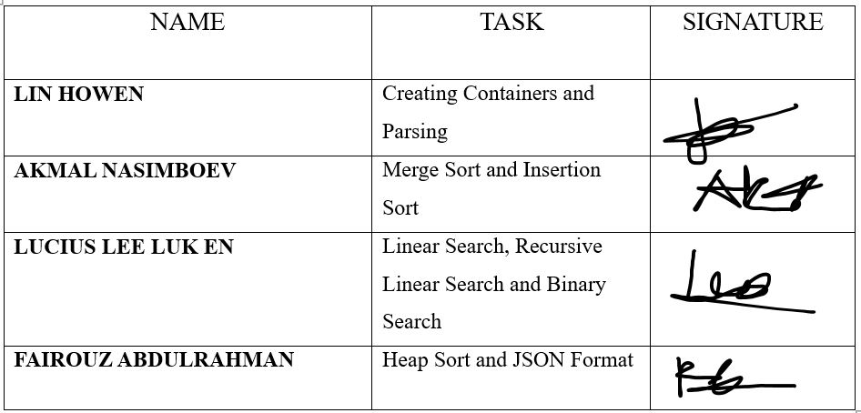

## Project overview

The application reads CSV transaction records, organizes data by payment channel, allows users to select an array or linked-list implementation, and offers sorting and searching workflows. Its documented features include:

- CSV parsing into a structured `Transaction` record
- Array-based and singly linked-list containers
- Payment channel filtering: UPI, CARD, ACH, and WIRE TRANSFER
- Sorting by transaction location using Merge Sort, Heap Sort, and Insertion Sort
- Searching by transaction type using Linear Search, Recursive Linear Search, and Binary Search
- JSON export of processed transaction records
- Console logging and comparison of algorithm execution times

The report introduces a banking-scale scenario of approximately **5 million transactions**; the illustrated console demonstration uses **20,000 transaction records**. These are different contexts and should not be confused.

## My technical contributions

### 1. Heap Sort implementation

I worked on the **Heap Sort** functionality, using a max-heap representation to sort transaction records by location. The `heapify` operation compares a parent with its left and right children, swaps when needed, and recursively restores the heap property.

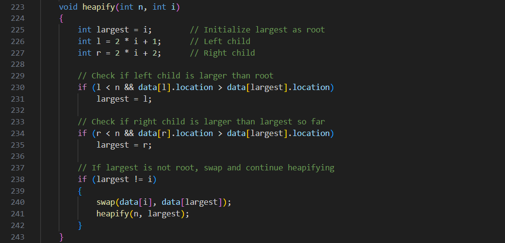

**Algorithm characteristics:** Heap Sort has `O(n log n)` time complexity and can sort an array in place with `O(1)` auxiliary array storage (excluding implementation-dependent call-stack usage). The screenshot shows the `heapify` component documented in the assignment.

### 2. JSON formatting and export

I also worked on **JSON formatting/export**, allowing processed transaction records to be saved in a structured, reusable format. The project documents a templated JSON export interface designed for different container types.

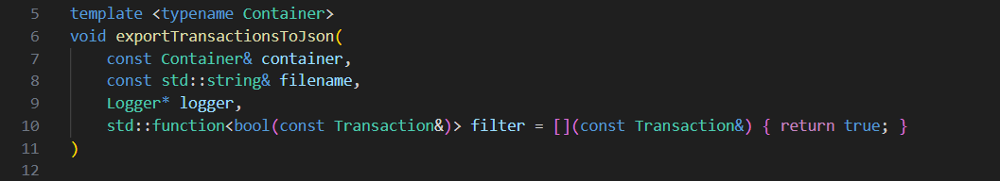

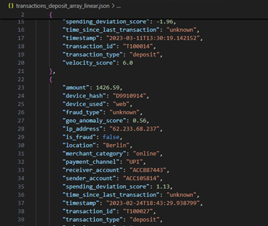

This export feature helps make the sorted and filtered results easier to inspect or reuse in subsequent analysis.

## System workflow

```text
CSV transaction dataset
         |
         v
Parse records into Transaction structs
         |
         v
Choose container: Array / Linked List / Both
         |
         v
Select payment channel (UPI / CARD / ACH / WIRE TRANSFER)
         |
         +--> Sort transactions by location
         |      +--> Merge Sort / Heap Sort / Insertion Sort
         |
         +--> Search by transaction type
         |      +--> Linear / Recursive Linear / Binary Search
         |
         v
Console results + logging + JSON export
```

## Data structures and algorithms

| Component | Purpose | Typical time complexity |
|---|---|---|
| Dynamic array | Indexable transaction storage | `O(1)` indexed access |
| Singly linked list | Node-based transaction storage | `O(n)` indexed traversal |
| Merge Sort | Divide-and-conquer sorting | `O(n log n)` |
| **Heap Sort — my contribution** | Max-heap-based sorting | **`O(n log n)`** |
| Insertion Sort | Sorting smaller or nearly sorted inputs | `O(n²)` worst case |
| Linear Search | Sequential transaction-type search | `O(n)` |
| Recursive Linear Search | Recursive linked-list traversal | `O(n)` |
| Binary Search | Search in pre-sorted data | `O(log n)` search only; sorting adds cost |

### Sorting implementation evidence

| Array Merge Sort | Linked List Merge Sort |
|---|---|
| 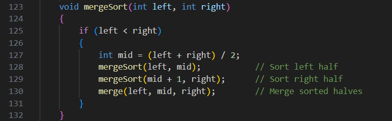 | 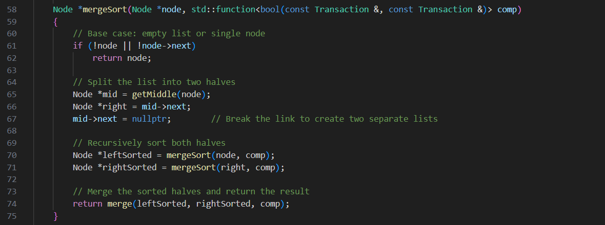 |

| Heap Sort | Insertion Sort |
|---|---|
|  | 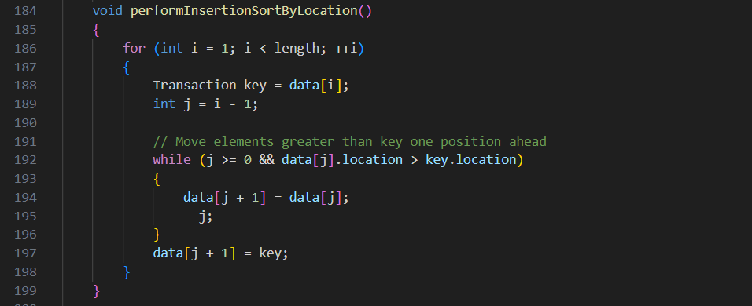 |

### Searching implementation evidence

| Linear | Recursive linear | Binary |
|---|---|---|
| 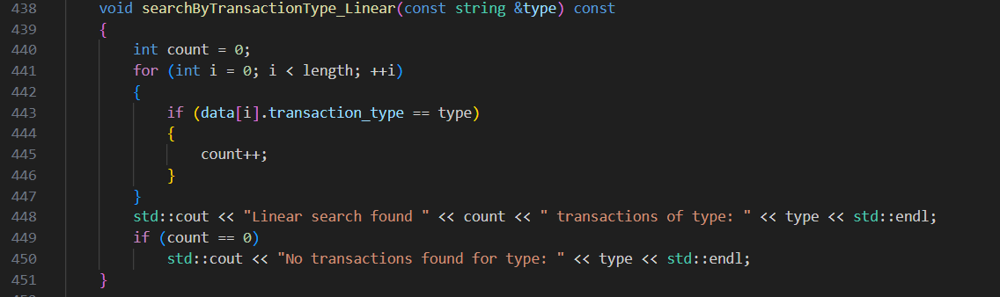 | 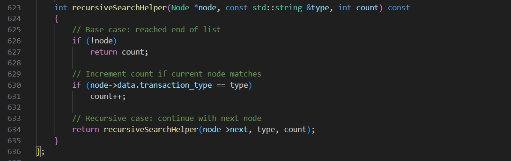 | 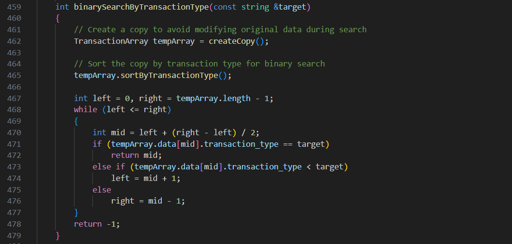 |

## Console demonstration

### Payment channel grouping

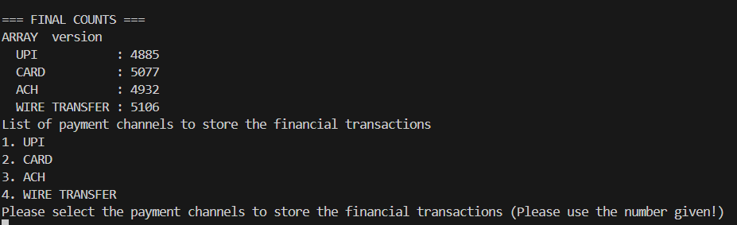

The illustrated dataset contains **4,885 UPI**, **5,077 CARD**, **4,932 ACH**, and **5,106 WIRE TRANSFER** transactions (20,000 in total).

### Sorting transactions by location

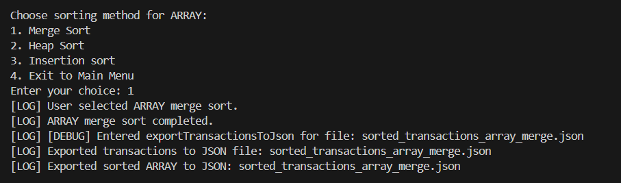

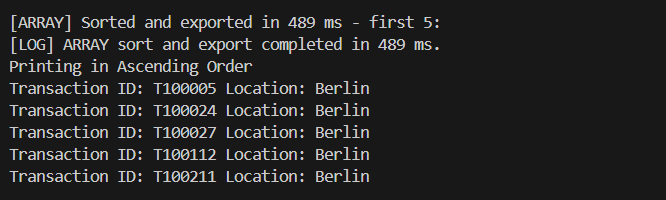

The report shows a sample array Merge Sort run completing in **489 ms**; this is a recorded example, not a general benchmark guarantee.

### Searching by transaction type

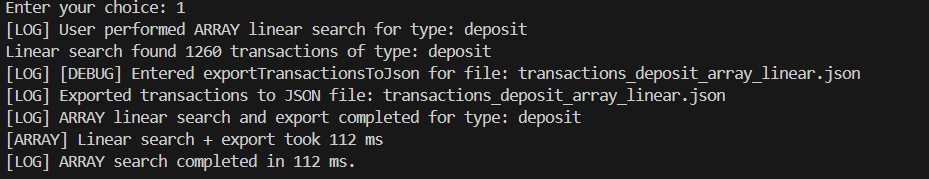

### Performance comparisons

The assignment includes comparative measurements for sorting and searching across the implemented containers. See the original tables below for the exact reported figures and test conditions.

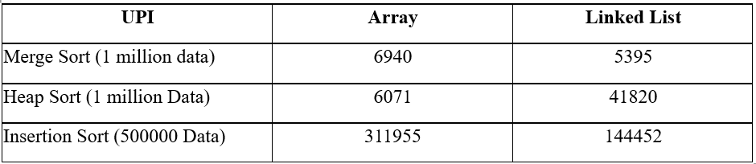

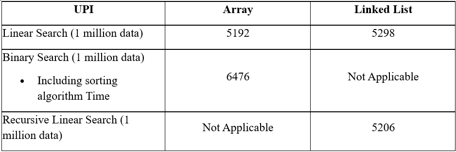

## C++ concepts demonstrated

- `struct`-based transaction modeling and CSV parsing
- Encapsulation, constructors, destructors, and operator overloading
- Templates and reusable functions
- Recursion and linked-list traversal
- Two-pointer technique for finding a linked-list midpoint
- Exception handling and string normalization
- Logging, output formatting, and file export

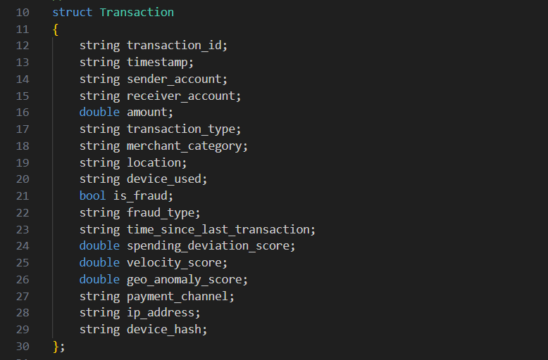

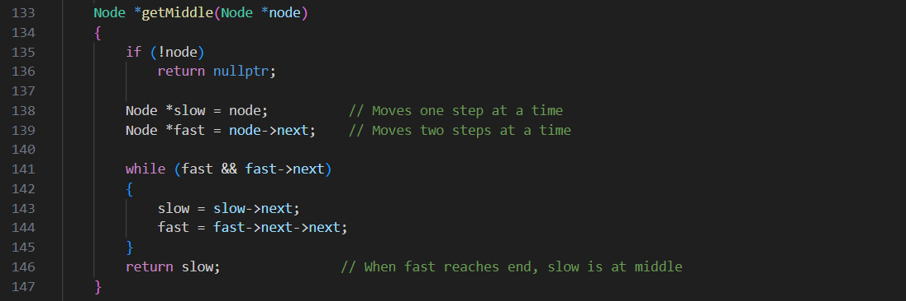

## Repository contents

- `README.md` — portfolio documentation
- `Original-Group-Assignment.docx` — submitted group report with explanations, source screenshots, test evidence, and references
- `*.png` — **18 original images** extracted from the assignment and placed in the repository root for reliable GitHub display

**Source-code availability:** The uploaded assignment documents C++ code through screenshots, but it does not supply a complete compilable `.cpp` project or the CSV input dataset. This repository is therefore an **evidence-based project portfolio**, not a claim that the software can be built from the supplied files alone.

## Academic attribution

**University:** Asia Pacific University of Technology & Innovation (APU)  
**Module:** Data Structures — CT077-3-2-DSTR  
**Project type:** Group assignment, 2025  
**My documented responsibility:** Heap Sort and JSON Format

The original workload matrix credits the other group members with container creation/parsing, Merge Sort/Insertion Sort, and the searching algorithms. Their work is acknowledged as part of the collaborative system.

---

*Prepared as a GitHub portfolio presentation of the original academic assignment. Screenshots and reported results are sourced from the submitted document.*
